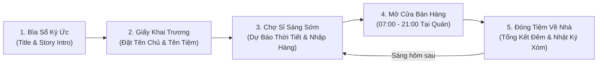

# Kế Hoạch Kiến Trúc Multi-Scene & Cốt Truyện Hoàn Chỉnh — "Tạp Hóa Màu Nước"

> [!IMPORTANT]
> **Mục tiêu cốt lõi:**
> 1. **Xóa bỏ triệt để sự chồng chéo UI/UX:** Không để thông báo Header đè lên mái hiên/biển hiệu quán, không nhồi nhét mọi tính năng vào cùng một màn hình lúc đang bán hàng.
> 2. **Xây dựng vòng lặp 5 Scene của một tựa game hoàn chỉnh:** Có Mở đầu cốt truyện (Story Intro) $\rightarrow$ Khai trương đặt tên Chủ quán & Tên Tạp hóa $\rightarrow$ Đi chợ đầu mối nhập hàng sáng sớm $\rightarrow$ Mở cửa bán hàng ban ngày $\rightarrow$ Đóng tiệm về nhà tổng kết sổ sách buổi tối.

---

## 1. Sơ Đồ Vòng Lặp 5 Scene (Complete Game Flow)

---

## 2. Chi Tiết Từng Scene & Giải Pháp UI/UX

### Scene 1: Bìa Sổ Ký Ức & Mở Đầu Cốt Truyện (`STORY_INTRO`)
* **Bối cảnh:** Mở đầu trên nền trang giấy sổ tay màu nước ấm áp, dẫn dắt người chơi vào câu chuyện trở về quê nhà tiếp quản tiệm tạp hóa nhỏ dưới gốc đa của bà ngoại.
* **Tương tác:**
  * Nút **`📖 Mở Trang Ký Ức Mới (Khởi Tạo Tiệm)`** dành cho lần đầu chơi.
  * Nút **`▶ Tiếp Tục Quản Lý Tiệm`** nếu người chơi muốn vào nhanh.

### Scene 2: Hồ Sơ Chủ Quán & Đặt Tên Biển Hiệu (`OWNER_SETUP`)
* **Thiết kế như "Giấy Đăng Ký Khai Trương Quầy Hàng":**
  * **Tên Chủ Quán (`player_name`):** Người chơi tự nhập tên mình (ví dụ: *Bà Ba, Cô Tư, Minh, An...* hoặc chọn nhanh gợi ý). Hàng xóm và học sinh khi vào mua hàng sẽ gọi đúng tên chủ quán (ví dụ: *"Cô Minh ơi cho cháu ghi sổ bữa nay nhé!"*).
  * **Tên Biển Hiệu Tạp Hóa (`store_name`):** Người chơi tự đặt tên quán (ví dụ: *TẠP HÓA BÀ BA*, *TIỆM KÝ ỨC*, *TẠP HÓA MÀU NƯỚC*). Tên này sẽ hiển thị trực tiếp trên **bảng gỗ trước hiên quán** và trên đầu Sổ Cái!
  * **Chọn Lợi Thế Khởi Nghiệp:**
    1. **Hiếu Khách Đầu Ngõ:** Khởi đầu với `+25 ♥ Tình làng xóm` & `+20 viên kẹo`.
    2. **Vốn Liếng Vững Vàng:** Khởi đầu với `60.000 đ` vốn tiền mặt.
    3. **Kho Hàng Sung Túc:** Khởi đầu với `16 gói` mỗi mặt hàng trong kho.

### Scene 3: Đi Chợ Đầu Mối Sáng Sớm (`MORNING_MARKET`)
* **Diễn ra trước 07:00 sáng mỗi ngày (hoặc bấm nút Chợ Sỉ):**
  * **Bản Tin Thời Tiết Đầu Ngõ:** Báo trước thời tiết hôm nay (*Nắng vàng*, *Mưa phùn*, hay *Gió mát*) kèm gợi ý mặt hàng sẽ bán chạy (ví dụ: Trời mưa khách lùng mua *Áo Mưa Giấy*, trời nắng học sinh mê *Kem Mút* & *Nước Ngọt*).
  * **Sạp Hàng Sỉ & Định Giá:** Cho phép nhập sỉ từng thùng hàng (`+8` hoặc `+16` gói), điều chỉnh giá bán lẻ và mua thêm kẹo lẻ trước khi mở cửa.
  * **Nút `🔓 Kéo Cửa Mở Hàng (Bắt đầu 07:00)`:** Chuyển vào cảnh bán hàng ban ngày.

### Scene 4: Cảnh Bán Hàng Ban Ngày — UI/UX Không Chồng Lấn (`DAYTIME_STORE`)
* **Xử lý triệt để lỗi Header đè lên biển hiệu quán:**
  1. **Hạ thấp vị trí vẽ mặt bằng quán & điều chỉnh khung nhìn Camera (`y = 405`):** Tạo khoảng trống thoáng đãng phía trên mái tôn/gỗ của tiệm để các thẻ HUD trên cùng không bao giờ chạm vào biển hiệu quán.
  2. **Toast Thông Báo Tự Ẩn (`Auto-Hide Paper Banner`):** Thay vì để dòng chữ hướng dẫn cố định suốt ngày đè lên mái quán, thông báo chỉ xuất hiện trong khung giấy nhỏ gọn **trong 3 giây khi có sự kiện rồi tự động mờ đi (`fade-out`)**, trả lại màn hình hoàn toàn sạch sẽ.
  3. **Biển Hiệu Gỗ Động:** Hiển thị tên tiệm và tên chủ quán do người chơi đặt.

### Scene 5: Đóng Tiệm Về Nhà & Nhật Ký Đêm (`NIGHT_HOME`)
* **Diễn ra lúc `21:00` tối (hoặc khi bấm `🌙 Đóng Tiệm Nghỉ Đêm`):**
  * **Bảng Tổng Kết Thu Chi Trong Ngày:**
    * Tổng doanh thu bán lẻ & tiền trà đá gốc đa.
    * Tổng tiền đã chi nhập hàng sỉ / đóng kệ trong ngày.
    * Số lượt khách hài lòng vs. số khách bỏ về.
  * **Kiểm Tra Sổ Ghi Nợ & Thu Hồi Nợ:** Xem danh sách hàng xóm đang nợ và đóng dấu thu nợ.
  * **Nhật Ký Đêm Xóm Nhỏ (Story Vignette):** Mỗi ngày kết thúc bằng một đoạn nhật ký ngắn giàu cảm xúc theo cấp độ tiệm và danh tiếng làng xóm.
  * **Nút `🌅 Đi Ngủ & Sáng Mai Đi Chợ Sỉ (Qua Ngày Mới)`:** Khép lại vòng lặp ngày và mở ra buổi sáng hôm sau.
