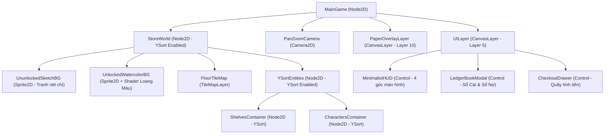

# Kế Hoạch Phát Triển Game "Tạp Hóa Màu Nước" Trên Godot Engine 4.x

Tài liệu này là bản thiết kế kỹ thuật (Technical Design & Implementation Plan) chi tiết để xây dựng tựa game **Quản lý Tạp Hóa góc nhìn 2D/2.5D** theo **Style 8 (Ký họa Bút mực & Màu nước thoáng đãng)** bằng **Godot Engine 4.3+ (GDScript)**.

---

## 1. Thông Số Kỹ Thuật & Cài Đặt Dự Án (Project Settings)

Để thể hiện trọn vẹn nét vẽ tay màu nước độ phân giải cao và khung cảnh rộng thoáng, dự án Godot 4 cần được cấu hình ngay từ đầu như sau:

| Hạng mục | Cấu hình đề xuất trong Godot 4 | Lý do kỹ thuật |
| :--- | :--- | :--- |
| **Phiên bản Engine** | **Godot 4.3 hoặc 4.4** (Standard GDScript) | Có sẵn node `TileMapLayer` mới và `AStarGrid2D` tối ưu hoàn hảo cho game xếp kệ theo ô lưới. |
| **Renderer** | **Compatibility** hoặc **Forward+** | Nhẹ, chạy mượt trên mọi máy PC văn phòng, Web và Mobile, hỗ trợ đầy đủ 2D Shader. |
| **Viewport Width / Height** | `1920 x 1080` (Full HD) | Giữ nét bút mực và vân giấy màu nước sắc nét (không dùng độ phân giải thấp của Pixel Art). |
| **Stretch Mode & Aspect** | Mode: `canvas_items` / Aspect: `expand` | Giữ UI sổ tay và tranh vẽ không bị bể hình khi thu phóng cửa sổ, tự động mở rộng tầm nhìn ở màn hình rộng. |
| **Texture Filter** | `Linear Mipmap` (Mặc định) | Làm mượt nét vẽ màu nước khi người chơi zoom xa/gần camera (`Camera2D`). |

---

## 2. Cấu Trúc Thư Mục Chuẩn (Folder Architecture)

Sử dụng kiến trúc tách biệt **Dữ liệu (`Resource`) - Giao diện (`UI`) - Thế giới (`World`)** để dễ dàng mở rộng hàng trăm món hàng và sự kiện mà không bị rối code:

```text
res://
├── autoloads/                 # Các Singleton chạy xuyên suốt game
│   ├── game_manager.gd        # Quản lý Ngày/Giờ, Thời tiết, Level quán
│   ├── economy_manager.gd     # Quản lý Tiền, Kho hàng, Sổ Ghi Nợ
│   └── event_bus.gd           # Kênh tín hiệu (Signals) kết nối UI và Thế giới
├── data/                      # Chứa các file dữ liệu (.tres) tạo từ Custom Resource
│   ├── items/                 # mi_tre_em.tres, keo_keo.tres, kem_mut.tres...
│   ├── furnitures/            # ke_go_nho.tres, tu_kem.tres, ban_tra_da.tres...
│   └── customers/             # cau_hoc_tro.tres, anh_sinh_vien.tres...
├── scenes/
│   ├── main/                  # main_game.tscn (Scene gốc kết hợp World + UI)
│   ├── world/                 # store_world.tscn, shelf.tscn, cashier_desk.tscn
│   ├── characters/            # player.tscn, customer_ai.tscn
│   └── ui/                    # hud.tscn, ledger_book.tscn, checkout_popup.tscn
├── scripts/
│   ├── resources/             # item_data.gd, furniture_data.gd, debt_record.gd
│   └── systems/               # grid_builder.gd, customer_spawner.gd
├── shaders/
│   ├── paper_overlay.gdshader # Phủ vân giấy mỹ thuật lên toàn màn hình
│   └── watercolor_reveal.gdshader # Hiệu ứng loang màu nước khi Up Level mở rộng quán
└── assets/
    ├── art/                   # Tranh màu nước (PNG tách nền), Texture vân giấy
    ├── fonts/                 # Font chữ viết tay bút mực (hỗ trợ tiếng Việt)
    └── audio/                 # Tiếng giấy sột soạt, dấu mộc, radio cũ, tiếng mưa
```

---

## 3. Kiến Trúc Node & Giải Pháp Kỹ Thuật Cốt Lõi

### 3.1. Sơ đồ Cây Scene Chính (`main_game.tscn`)



### 3.2. Giải quyết 4 Bài toán Kỹ thuật quan trọng nhất

#### A. Mặt bằng rộng thoáng & Sắp xếp chiều sâu (`TileMapLayer` + `YSort`)
* **Góc nhìn:** Chọn **Isometric (2.5D)** hoặc **Top-Down 3/4** trong `TileSet`.
* **Chiều sâu tự động:** Chỉ cần bật `y_sort_enabled = true` trên node `YSortEntities`, `ShelvesContainer` và `CharactersContainer`. Đặt tâm (Origin/Offset) của Sprite kệ hàng và nhân vật ở **dưới chân**. Godot 4 sẽ tự động vẽ nhân vật khuất sau kệ hàng khi đi phía trên và đè lên kệ hàng khi đứng phía trước.

#### B. Tìm đường thông minh khi người chơi xếp kệ (`AStarGrid2D`)
* Thay vì dùng `NavigationRegion2D` phức tạp, game quản lý cửa hàng theo ô lưới nên dùng class tích hợp sẵn **`AStarGrid2D`**:
  * Khi khởi tạo mặt bằng quán (ví dụ lưới `20x15` ô), `AStarGrid2D` quản lý toàn bộ các ô đi được.
  * Khi người chơi đặt một chiếc kệ vào ô `(x, y)`, chỉ cần gọi:
    ```gdscript
    astar_grid.set_point_solid(Vector2i(x, y), true)
    ```
  * Khách hàng (`CustomerAI`) chỉ cần gọi `astar_grid.get_id_path(start_cell, target_shelf_cell)` là có ngay đường đi mượt mà lách qua các dãy kệ.

#### C. Quản lý Hàng hóa bằng `Custom Resource` (Không cần Database phức tạp)
Tạo script `item_data.gd` để có thể thêm món hàng mới ngay trên giao diện Inspector của Godot:
```gdscript
class_name ItemData
extends Resource

@export var id: String
@export var display_name: String          # VD: "Mì trẻ em", "Kem mút đậu xanh"
@export var icon: Texture2D               # Icon vẽ màu nước
@export var wholesale_cost: int = 1000    # Giá nhập sỉ
@export var default_price: int = 2000     # Giá bán lẻ gợi ý
@export_enum("Snack", "Drink", "Household", "Seasonal") var category: String
@export var weather_boost: String = "Any" # "Sunny" (bán chạy khi nắng), "Rainy" (khi mưa)
```

#### D. Bí quyết Đồ họa "Style 8 - Màu Nước & Loang Màu Up Level"
1. **Lớp phủ Vân Giấy (`PaperOverlayLayer`):**
   * Đặt một `TextureRect` (chứa ảnh vân giấy mỹ thuật `paper_texture.png`) phủ kín màn hình (`Full Rect`), đặt `mouse_filter = Ignore` (để không chặn click chuột), và gắn `CanvasItemMaterial` với chế độ `Blend Mode = Multiply`. Toàn bộ game và UI bên dưới sẽ lập tức ăn khớp trên cùng một mặt giấy!
2. **Hiệu ứng "Tô Màu Mở Rộng Khu Phố" khi Lên Cấp (`watercolor_reveal.gdshader`):**
   * Mặt bằng quán có 2 bức ảnh chồng lên nhau: Lớp dưới là **Nét phác bút chì trên giấy trắng**, lớp trên là **Tranh màu nước đầy đủ**.
   * Dùng một Shader nhận vào biến `unlock_radius` kết hợp với `NoiseTexture2D` (vân loang) để khi người chơi lên Level, màu nước sẽ loang tự nhiên từ tâm quán ra sân hiên và vỉa hè.

---

## 4. Lộ Trình Thực Hiện 4 Giai Đoạn (Milestones)

> [!TIP]
> **Nguyên tắc vàng:** Ở Giai đoạn 1 và 2, bạn có thể dùng các hình vẽ phác thảo đơn giản (Placeholder) để test mượt toàn bộ logic mua bán, sau đó mới đưa tranh màu nước hoàn chỉnh vào ở Giai đoạn 3.

### 📍 Giai đoạn 1: Khung Xương Mặt Bằng & AI Khách Hàng (Tuần 1 - 2)
* **Mục tiêu:** Đặt được kệ hàng trên mặt bằng rộng, khách biết đi vào lấy đồ và ra quầy tính tiền.
* **Công việc cụ thể:**
  - [ ] Khởi tạo project Godot 4, thiết lập `Camera2D` cho phép kéo (Pan) nhẹ và phóng to/thu nhỏ (Zoom) mượt mà.
  - [ ] Tạo hệ thống lưới `GridBuilder`: Cho phép chọn kệ hàng từ thanh công cụ dưới đáy màn hình và đặt lên sàn quán.
  - [ ] Lập trình `Shelf` node: Lưu trữ loại mặt hàng (`ItemData`) và số lượng hiện có trên kệ; hiển thị sprite hàng hóa đầy/vơi tương ứng.
  - [ ] Lập trình `CustomerAI` với máy trạng thái (State Machine) 5 bước:
    1. `ENTERING`: Đi từ vỉa hè vào cửa quán.
    2. `BROWSING`: Tìm kệ có món đồ muốn mua (hiện bong bóng màu nước trên đầu).
    3. `WAITING_CHECKOUT`: Xếp hàng tại quầy thu ngân.
    4. `PAYING`: Tương tác tính tiền hoặc xin ghi nợ.
    5. `LEAVING`: Rời quán và cộng tiền/điểm uy tín.

### 📍 Giai đoạn 2: Vòng Lặp Kinh Tế, Thu Ngân & Sổ Ghi Nợ (Tuần 3 - 4)
* **Mục tiêu:** Hoàn thiện vòng lặp 1 ngày (Sáng - Trưa - Tối) và các cơ chế đặc trưng của tiệm tạp hóa Việt Nam.
* **Công việc cụ thể:**
  - [ ] Xây dựng `GameManager`: Đồng hồ chạy từ `06:00` đến `21:00`, hệ thống Ngày, và phát tín hiệu chuyển pha (Chuẩn bị sáng $\rightarrow$ Mở cửa $\rightarrow$ Đóng cửa tổng kết).
  - [ ] Xây dựng UI **Sổ Cái (`LedgerBookModal`)** với 3 tab băng dính giấy:
    * **Tab Nhập Sỉ:** Đặt thùng hàng, trừ vốn, sáng hôm sau giao tới cửa.
    * **Tab Kho & Giá Bán:** Điều chỉnh giá bán lẻ (tác động đến thái độ đắt/rẻ của khách).
    * **Tab Sổ Ghi Nợ:** Danh sách hàng xóm đang nợ, số tiền, ngày hẹn trả, và nút đóng dấu mộc đỏ `"ĐÃ THU"`.
  - [ ] Xây dựng UI **Quầy Thu Ngân (`CheckoutDrawer`)**:
    * Tính tiền nhanh hoặc Mini-game thối tiền lẻ (kèm hũ kẹo để **thối kẹo thay tiền lẻ**).
    * Xử lý sự kiện khách quen xin mua chịu (Cho nợ $\rightarrow$ Tăng Tình Làng Nghĩa Xóm; Từ chối $\rightarrow$ Giảm thiện cảm).

### 📍 Giai đoạn 3: Mỹ Thuật Style 8, Thời Tiết & Lên Cấp Loang Màu (Tuần 5 - 6)
* **Mục tiêu:** Đưa trọn vẹn chất nghệ thuật Màu nước & Bút mực vào game và thêm biến động mỗi ngày.
* **Công việc cụ thể:**
  - [ ] Áp dụng lớp phủ `PaperOverlayLayer` và thay toàn bộ UI sang dạng mảnh giấy xé, con dấu mộc, font chữ bút mực.
  - [ ] Viết shader `watercolor_reveal.gdshader` cho cơ chế **Up Level Mở Rộng Quán** (Level 1: Hiên nhà $\rightarrow$ Level 2: Sân cây bàng & Tủ kem $\rightarrow$ Level 3: Vỉa hè trà đá & Máy điện tử xèng).
  - [ ] Lập trình hệ thống **Thời tiết & Sự kiện trong ngày**:
    * Radio buổi sáng báo: *Nắng gắt*, *Mưa rào*, hoặc *Cúp điện*.
    * Khung giờ cao điểm **Tan trường (`11:30` & `17:00`)**: Tăng tốc độ sinh khách học sinh mua quà vặt trong 45 giây.

### 📍 Giai đoạn 4: Cốt Truyện Khu Phố, Âm Thanh & Đóng Gói (Tuần 7 - 8)
* **Mục tiêu:** Thổi hồn cảm xúc vào game và cân bằng độ khó.
* **Công việc cụ thể:**
  - [ ] Thiết kế 5 vị **Khách quen cốt truyện (Story NPCs)** với chuỗi sự kiện ngắn (Cậu học trò nghèo, Anh sinh viên kiến trúc, Bà cụ hay quên...) và phần thưởng **Kỷ vật trưng bày** trong quán.
  - [ ] Thêm hiệu ứng **Juice & Audio**:
    * Dùng `Tween` làm hiệu ứng nảy nhẹ khi đặt kệ, hiệu ứng rung nhẹ khi đóng dấu mộc `"CỘP!"`.
    * Lồng tiếng lật trang giấy, tiếng bút gạch sổ, tiếng tiền lẻ, tiếng ve kêu trưa hè / tiếng mưa rơi trên mái hiên.
  - [ ] Cân bằng kinh tế (giá nhập, tiền lời, chi phí mở rộng) và xuất bản (Export) ra Windows / Web / Mobile.

---

## 5. Bước Khởi Đầu Tiếp Theo

Chúng ta có thể bắt tay vào thực hiện ngay **Giai đoạn 1** bằng cách:
1. Mình sẽ **khởi tạo sẵn bộ khung dự án Godot 4 chuẩn** ngay trong thư mục `c:\cty` của bạn (bao gồm `project.godot`, các Autoload `GameManager`/`EconomyManager`, hệ thống `ItemData` Resource, hệ thống lưới `AStarGrid2D`, và Shader vân giấy/màu nước).
2. Sau đó bạn chỉ cần mở **Godot 4** lên, chọn thư mục `c:\cty` và bấm **Run (F5)** là có ngay mặt bằng quán màu nước chạy thử được!
